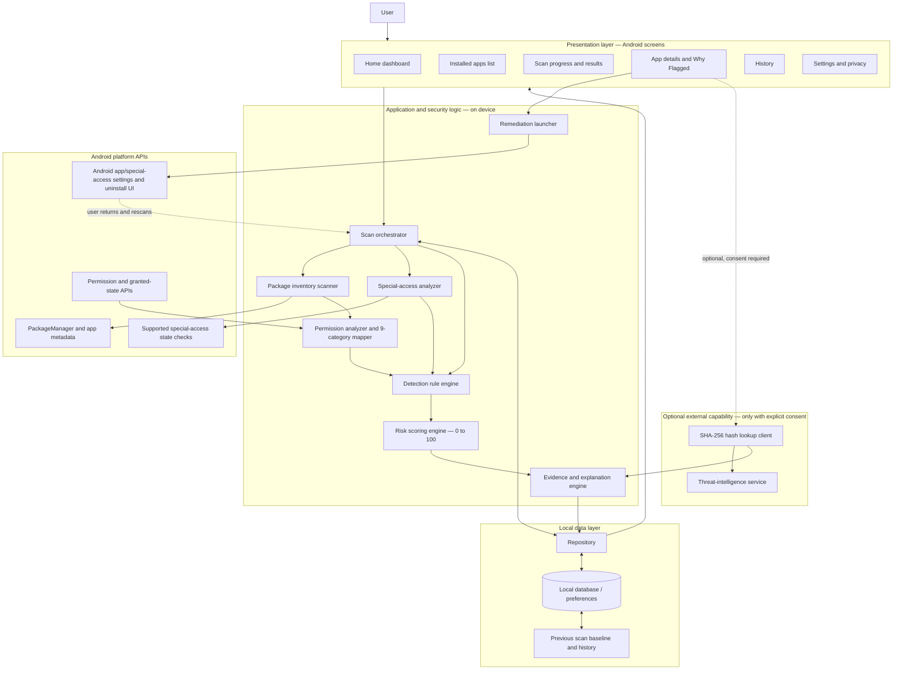
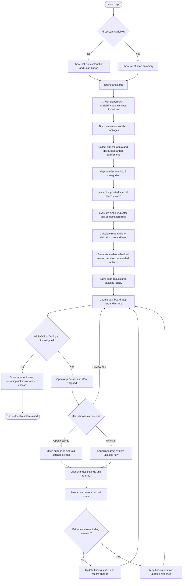

# On-Device App Risk Auditor
## Android Application Architecture, Security Requirements, and End-to-End Workflow

**Document purpose:** This document is the implementation blueprint for an Android application that audits installed apps for permission-related and special-access risks. It is written to be directly usable as context for Claude or another coding agent.

**Primary requirement:** Build a genuinely functional, security-focused Android application. Correct on-device scanning, evidence-backed detection, explainable scoring, privacy, and remediation take priority over visual polish.

**Important time constraint:** The desired implementation window discussed for an AI coding agent is approximately 45 minutes. The complete feature set is documented here, but this time limit is aggressive. Implement the mandatory vertical slice first, then add optional features only when they can be implemented and tested honestly. Never replace working security logic with fabricated data or nonfunctional buttons.

---

## 1. Project Summary

### 1.1 Project name

**On-Device App Risk Auditor**

### 1.2 Problem being solved

Users often cannot easily tell which installed Android applications have sensitive permissions or powerful special access, why those permissions matter, or what they can do to reduce the risk.

The app must scan installed applications, inspect available permission and special-access information, organize findings into clear categories, assign a repeatable risk score, explain every significant finding, and direct the user to supported Android remediation flows.

### 1.3 Questions the product must answer

1. **Which installed apps may pose the greatest risk?**
2. **Why was each app flagged?**
3. **What can the user do about the finding now?**

### 1.4 Core product principle

The product is a security auditing tool, not just a permission viewer or a dashboard mock-up.

Required processing cycle:

**Scan → Normalize → Categorize → Detect → Score → Explain → Present → Remediate → Verify → Record**

Core scanning and analysis must work locally, without root access or requiring the end user to use ADB.

### At-a-glance diagrams

The diagrams below show the two things an implementation agent must understand first: **how the modules connect** and **how the user moves through a real security scan**. They are written in Mermaid so compatible Markdown viewers can render them; the source is also readable as plain text.

#### Diagram 1 — System architecture

**How to read it:** The UI never invents a score. The scan orchestrator gathers observations through supported Android APIs; analyzers normalize them; the rule engine detects risks; the scoring and explanation engines create a traceable result; and the local repository stores it for screens and history. The optional external lookup is isolated and must not be needed for core scanning.

#### Diagram 2 — End-to-end user and scan workflow

**Security rule for the workflow:** opening Settings or uninstalling an app is not proof of remediation. The auditor must rescan and verify the actual observed state before marking a finding resolved.

---

## 2. Source Requirements and Scope Classification

The original hackathon problem statement defines the following feature classes. Keep these classifications in project documentation.

### 2.1 Mandatory features — must be implemented

1. Installed-app inventory.
2. Declared-versus-granted permission extraction and protection-level classification.
3. Nine permission categories, per app and device-wide.
4. Special-access detection.
5. Risk score from 0–100, four risk bands, and at least three human-readable reasons for each High or Critical app.
6. App detail screen with a “Why Flagged?” panel, system settings action, and uninstall action.

### 2.2 Should-have features — implement after the mandatory flow

7. Suspicious permission combination rules.
8. App-purpose/context mismatch detection.
9. App installation and update monitoring with High/Critical notifications.
10. Permission-change detection.

### 2.3 Stretch features — only after core functionality works

11. SHA-256 APK hash lookup against a threat-intelligence service, with explicit consent and hashes only.
12. Static APK manifest checks for exported components, cleartext traffic configuration, and debuggable configuration.
13. Optional on-device ML estimate, separate from the explainable rule-based score.
14. Shareable PDF scan report.

### 2.4 Additional security/product enhancements discussed

15. Security posture dashboard with live scan statistics.
16. Evidence-backed findings and rule traceability.
17. Recalculation after remediation.
18. Local scan and security-event history.
19. Offline-first operation.
20. Privacy and network transparency.
21. Safe error handling and explicit unknown/unsupported states.
22. Optional security timeline.
23. Optional static configuration checks beyond the initial minimum where supported.
24. Optional PDF reporting and advanced security analytics.

Do not treat additional enhancements as official mandatory items from the source problem statement. They are product recommendations built on top of it.

---

## 3. Navigation and Screen Architecture

Use a simple mobile-first interface. Recommended bottom navigation:

1. **Home**
2. **Apps**
3. **Scan**
4. **History**
5. **Settings**

The **App Details** screen is a separate destination opened from app cards or findings. Notifications are opened from a bell icon in the top bar.

### 3.1 Global app shell

Every primary screen should share:
- App name and a consistent security-oriented visual style.
- A top bar with a notification/history alert entry where useful.
- Bottom navigation with the five destinations above.
- Clear loading, empty, error, permission-unavailable, and scan-in-progress states.
- Accessible labels and readable severity indicators.
- A consistent way to return from app details to the previous screen.

Avoid overcomplicated animations or decorative charts that do not help the user investigate risk.

### 3.2 Home — Security Dashboard

**Purpose:** Show the current state of device security and direct the user to the most important action.

Components:
- Security status derived from the most recent completed scan.
- First-run state: “Not scanned yet” and a prominent “Scan installed apps” button.
- Scan/rescan button.
- Last successful scan time and scan status.
- Total apps inspected.
- Counts of Low, Medium, High, and Critical applications.
- Count of apps with detected special access.
- Highest-risk apps with score and primary evidence-based reason.
- Important security findings and suspicious combinations.
- Incomplete scan warning, if any.
- Shortcuts to the filtered Apps list and app details.

Rules:
- Do not show fabricated counts or pretend that a scan completed when it did not.
- If the scan is incomplete, state the limitation.
- Do not label the device “safe” merely because no finding was detected. Prefer wording such as “No High-Risk Findings Detected by This Scan.”
- Tapping a summary card should open the relevant app list filtered by that category.

### 3.3 Apps — Installed Application Inventory

**Purpose:** Browse and filter all visible installed user apps, with an optional system-app toggle.

Top controls:
- Search by app label or package name.
- Filter by Low, Medium, High, Critical, and All.
- Filter for apps with special access.
- Sort by risk score, app name, or installation date when available.
- Toggle to include system applications.
- Refresh/rescan action.

Each app row/card:
- App icon (or safe fallback icon).
- App label.
- Package name.
- Version information where available.
- Installer source where available.
- Risk score and risk level.
- Special-access indicator when applicable.
- Brief primary finding.

Selecting a row opens App Details.

Do not equate an unknown installer source with confirmed sideloading. Display “Unknown” if unavailable. Package visibility and Android version limitations must be represented honestly.

### 3.4 Scan — Scan Control and Results

**Purpose:** Start and explain the scan pipeline.

Before scanning:
- Explain that core scan analysis occurs on-device.
- Show Start Scan / Rescan.
- Explain any required access or platform limitations in plain language.

During scanning:
- Show real progress where measurable, or clear stages if total progress is not available.
- Show current stage: inventory, permission extraction, special-access inspection, rule evaluation, scoring, and saving results.
- Show number of inspected apps where possible.
- Permit safe cancellation if supported.

After scanning:
- Show completion status and time.
- Show app totals and risk-band counts.
- Show any failures, skipped apps, unknown fields, or unsupported checks.
- Link to High/Critical findings and the full inventory.
- Save the scan result locally.

Do not use a progress animation as a substitute for scanning actual packages.

### 3.5 App Details — Investigation and Remediation

This is the most important security screen after the dashboard.

Sections:

**A. App identity**
- App label and icon.
- Package name.
- Version name/code where available.
- Install date where available.
- Installer source where available.
- Target SDK.
- System/user app classification.

**B. Risk summary**
- Score from 0–100.
- Risk band.
- Last scan timestamp.
- Data completeness/inspection limitations.
- Explain that a risk score is a rule-based estimate, not proof that an app is malicious.

**C. “Why Flagged?”**
- At least three distinct, supported, human-readable reasons for each High/Critical app.
- Finding title and severity.
- Actual observed permission or special-access state.
- Triggered rule ID/name.
- Points contributed to the score.
- Plain-language potential impact.
- Recommended action.

Do not fabricate three reasons if fewer than three independent findings exist. Instead show only supported evidence and explicitly flag that the mandatory explanation requirement has not been met by the current rules; improve the rule coverage.

**D. Permissions**
- Declared permissions.
- Granted permissions.
- Declared but not granted permissions.
- Protection level where available: normal, dangerous, signature, special.
- Category.
- Short explanation.
- Unknown/unavailable state when appropriate.

**E. Special access**
- Accessibility services: relevant enabled service state where reliably detectable.
- Active device-admin state.
- Enabled notification listener state.
- Overlay capability/declaration and current grant state where available.
- Install-packages capability and relevant grant state where available.
- Usage statistics access where reliably detectable.
- Clear distinction between declaration, request, grant, and enabled state.

**F. Optional static-analysis findings**
- Exported components.
- Cleartext traffic configuration.
- Debuggable configuration.
- Source/evidence and limitation for each result.

**G. Actions**
- Open Android application settings.
- Open relevant special-access settings where supported.
- Rescan/recalculate.
- Uninstall through the supported Android system flow.
- View scan history for the app, if implemented.
- Export/share report, if implemented.

Android may require user confirmation and does not allow a normal auditor to silently revoke every permission or uninstall arbitrary apps. Do not promise unsupported remediation.

### 3.6 History — Scan History and Change Timeline

**Purpose:** Show how findings and risk changed over time.

Include:
- Scan date/time and completion status.
- Number of apps inspected.
- Risk-band counts.
- New High/Critical findings.
- Score increases/decreases.
- New declared permissions and newly granted permissions where detected.
- Changes in special access where detectable.
- Remediation verification results.
- Errors or incomplete checks.
- Clear history action.

Selecting a scan opens a read-only historical snapshot. Clearly distinguish historical results from the latest app state.

Keep history local. Do not store more app information than needed for the audit.

### 3.7 Settings — Privacy and Optional Controls

**Scan options**
- Include/exclude system apps.
- Supported installation/update monitoring preference.
- Optional static-analysis checks.
- Manual rescan.

**Privacy**
- Explain on-device processing.
- Explain optional hash lookup and the exact information that may leave the device.
- Explicit consent control for external hash lookups.
- Clear local history.
- Show whether external lookup is enabled.

**Advanced features**
- SHA-256 lookup, if actually integrated.
- Static manifest inspection, if actually integrated.
- ML estimate, if a real pre-trained model is integrated.
- PDF export, if implemented.

Never show controls that imply a feature works when it does not. Do not add analytics or telemetry that violates the privacy requirement.

### 3.8 Notifications

Use notifications for:
- A newly detected High/Critical risk after a scan.
- A newly added sensitive permission after an update, if detected.
- A relevant special-access change, if detected.
- Scan completion or scan failure when notification delivery is implemented.

Each notification should navigate to the corresponding finding or app details.

Do not generate fake security alerts. Android background-execution restrictions apply; use supported mechanisms and do not promise continuous monitoring unless it genuinely works.

---

## 4. The Nine Mandatory Permission Categories

Every scan must categorize relevant permissions/access under all nine categories. The category list is based on the original problem statement.

### 4.1 Special Access — highest weight

Examples:
- Accessibility services.
- `SYSTEM_ALERT_WINDOW` / overlay.
- Device administrator.
- Notification listener.
- `REQUEST_INSTALL_PACKAGES`.
- `PACKAGE_USAGE_STATS`.

Potential impact:
- Screen reading.
- Fake login overlays.
- Notification/OTP exposure.
- Uninstall resistance.
- Installing additional apps.

### 4.2 SMS

Examples:
- `READ_SMS`
- `RECEIVE_SMS`
- `SEND_SMS`

Potential impact: OTP theft and premium SMS fraud.

### 4.3 Contacts and Call Logs

Examples:
- `READ_CONTACTS`
- `READ_CALL_LOG`

Potential impact: contact harvesting, scams, and extortion.

### 4.4 Camera and Microphone

Examples:
- `CAMERA`
- `RECORD_AUDIO`

Potential impact: unauthorized recording.

### 4.5 Location

Examples:
- `ACCESS_FINE_LOCATION`
- `ACCESS_BACKGROUND_LOCATION`

Potential impact: tracking and stalking.

### 4.6 Phone and Identity

Examples:
- `READ_PHONE_STATE`
- `READ_PHONE_NUMBERS`
- `CALL_PHONE`

Potential impact: device fingerprinting and call fraud.

### 4.7 Storage and Media

Examples:
- `READ_MEDIA_IMAGES`
- `MANAGE_EXTERNAL_STORAGE`

Potential impact: access to photos and documents.

### 4.8 Background and Persistence

Examples:
- `RECEIVE_BOOT_COMPLETED`
- `FOREGROUND_SERVICE`
- `REQUEST_IGNORE_BATTERY_OPTIMIZATIONS`

Potential impact: continued background operation and persistence.

### 4.9 Network

Examples:
- `INTERNET`
- `ACCESS_NETWORK_STATE`

Potential impact: potential data exfiltration, especially when combined with sensitive access.

Network access alone is common and must not automatically result in High or Critical risk.

---

## 5. Security Detection Rules

The rule engine is the core differentiator of this application. It must be deterministic, testable, evidence-backed, and separate from the UI.

### 5.1 Single indicators

Detect available evidence for:
- Sensitive declared permissions.
- Sensitive granted permissions.
- Enabled special access.
- Background/persistence-related permissions.
- Broad storage access.
- Sensitive data access.
- Potentially unsafe manifest configuration, if static inspection exists.
- Known malicious hash match, if optional threat intelligence exists.

A declared but ungranted permission must not be represented as currently granted access.

### 5.2 Combination rules

Implement rules such as:

**Rule R001 — SMS + Network + Persistence**
- Conditions: relevant SMS permission/access, network permission, persistence indicator.
- Additional context: sideloaded/unknown installer source if available.
- Meaning: combination may enable access to SMS and a potential communication channel with continued background execution.
- Severity: elevated; final severity depends on all evidence and scoring.

**Rule R002 — Accessibility + Overlay**
- Conditions: enabled Accessibility service and relevant overlay capability/grant.
- Meaning: combination can increase risk of screen interaction abuse or fake login overlays.
- Important: do not claim malicious behavior solely from these states.

**Rule R003 — Notification Listener + Network**
- Conditions: enabled notification listener and network capability.
- Meaning: sensitive notifications may be accessible and network access exists.
- Explain the potential, not proven, data exfiltration.

**Rule R004 — Unusual Device Administrator**
- Conditions: app is an active device administrator and its apparent role does not clearly explain the privilege.
- Meaning: elevated device control may be unnecessary.
- Do not assume every non-security app is malicious; role/category evidence may be incomplete.

**Rule R005 — App-Purpose Mismatch**
- Conditions: available label/category suggests a simple utility, but sensitive permissions appear unrelated.
- Examples: calculator with SMS access; flashlight with call-log access.
- Meaning: access is inconsistent with the apparent purpose.
- This is a heuristic and must be labelled as such.

**Rule R006 — Broad Storage + Network**
- Conditions: broad storage/media access and internet capability.
- Meaning: potentially sensitive local data access plus a possible network channel.
- Do not claim exfiltration occurred.

**Rule R007 — Multiple High-Impact Special Access**
- Conditions: multiple relevant high-impact special-access states are enabled.
- Meaning: greater potential impact if abused.
- Avoid duplicate scoring for overlapping rules.

**Rule R008 — Newly Added Sensitive Permission**
- Conditions: current observed declaration/grant state differs from stored baseline.
- Meaning: application capability or granted access has changed.
- Report declared and granted changes separately.

**Rule R009 — Known Malicious Hash**
- Conditions: optional trusted threat-intelligence lookup returns a reliable match.
- Meaning: hash matches a record in the named source.
- Record source, timestamp, and lookup status. Do not treat no match as proof of safety.

### 5.3 Rule result structure

Every rule result should include:
- Stable rule ID.
- Rule name.
- App package identifier.
- Trigger status.
- Evidence list.
- Severity.
- Score contribution.
- Plain-language explanation.
- Potential impact.
- Suggested action.
- Timestamp.
- Data-quality/limitations information.

The explanation engine must derive text from actual rule results. Do not generate explanations from hardcoded sample apps.

---

## 6. Risk Scoring Model

The source problem statement requires:
- A score from 0 to 100.
- Four risk bands.
- At least three human-readable reasons for each High/Critical application.

The source does not specify exact numerical thresholds or weights. Use the following as a configurable starting proposal, not as official source-defined values.

### 6.1 Proposed risk bands

- Low: 0–24.
- Medium: 25–49.
- High: 50–74.
- Critical: 75–100.

### 6.2 Proposed starting weights

- Enabled high-impact special access: +15 to +30.
- Sensitive SMS/contacts/call logs/camera/microphone/location/media access: +5 to +15.
- Background/persistence indicators: +5 to +10.
- Suspicious combination: +10 to +25.
- App-purpose mismatch: +5 to +15.
- Reliable known-malicious hash match: a strong separate indicator, subject to source confidence and validation.

These are example ranges. Document the chosen final weights in a one-page scoring rubric.

### 6.3 Scoring requirements

- Score must be deterministic for the same observed state and rule version.
- Final score is capped at 100.
- Avoid double-counting the same evidence across overlapping rules.
- Keep a traceable list of score contributions.
- Do not give internet permission a high score by itself.
- Treat unavailable evidence as unknown, not safe.
- Distinguish risk indicators from confirmed malware.
- Do not inflate the score just to reach a target band.
- Keep rule-based scoring as the primary explainable result, even if ML is added.

### 6.4 High/Critical explanation requirement

Each High/Critical app should show at least three distinct supported reasons. Reasons must be based on actual evidence. If fewer than three independent reasons exist, do not fabricate reasons; improve rule coverage and clearly identify the limitation.

---

## 7. End-to-End Functional Workflow

The high-level workflow diagram appears in Section 1. The detailed sequence below defines what each step must do and what data it passes to the next step. Treat the diagram as the overview and these numbered steps as the implementation checklist.

### 7.1 First launch

1. Start the app.
2. Show a concise explanation of what the auditor checks and that core processing is local.
3. Show the Home first-run state.
4. User taps “Scan installed apps.”
5. Check and explain any necessary access or platform limitations.
6. Begin the scan.

### 7.2 Scan pipeline

1. Discover packages visible to the app through supported Android APIs.
2. Filter to user-installed apps by default; optionally include system apps.
3. Retrieve available app metadata.
4. Extract declared permissions.
5. Retrieve granted permission states where supported.
6. Map permissions to the nine categories.
7. Inspect available special-access states.
8. Run optional static manifest checks only if implemented.
9. Run individual indicator rules.
10. Run combination rules.
11. Evaluate context-mismatch heuristics.
12. Calculate the risk score and band.
13. Generate evidence-backed explanations.
14. Store results and a baseline locally.
15. Update the dashboard and app inventory.
16. Show scan completion, limitations, and findings.

### 7.3 Investigation and remediation

1. User selects a High/Critical finding.
2. Open App Details.
3. Show app metadata, score, category breakdown, and evidence.
4. Explain why each rule triggered and its contribution.
5. Show recommended action.
6. User may open Android app settings or a supported special-access settings screen.
7. User may initiate the Android uninstall flow.
8. User returns to the auditor.
9. Rescan the affected app/device.
10. Recalculate score based on newly observed state.
11. Mark findings resolved only when the evidence supports resolution.
12. Store the new state and change history.

### 7.4 Subsequent scan and change detection

1. User starts a scan, or a supported package-install/update event triggers a refresh.
2. Refresh available app metadata and access states.
3. Compare with the previous baseline.
4. Identify newly declared or newly granted sensitive permissions.
5. Identify relevant special-access changes where detectable.
6. Re-run detection and scoring.
7. Generate an alert for new High/Critical findings if notifications are supported.
8. Update local history and dashboard.

### 7.5 Optional hash lookup

1. User opens the optional lookup feature.
2. Explain the external request and data sent.
3. Obtain explicit consent.
4. Calculate SHA-256 of the base APK where supported.
5. Send only the hash to the configured threat-intelligence service.
6. Display source, match/no-match/inconclusive status, and timestamp.
7. Do not upload the APK or installed-app inventory.
8. Do not treat no match as proof of safety.
9. Continue to support the rest of the app offline.

---

## 8. Architecture and Module Boundaries

The system architecture diagram in Section 1 is the component map. This section defines the responsibilities and boundaries in more detail. Keep the UI, Android API access, security analysis, and persistence separated so that scanning and scoring can be tested independently of the screens.

Separate the UI from platform access, security rules, scoring, and persistence. Keep the architecture simple enough for a small Android implementation.

### 8.1 Suggested layers

**Presentation layer**
- Home screen.
- Apps screen.
- Scan screen.
- App Details screen.
- History screen.
- Settings screen.
- Notifications list.

Responsibilities:
- Display state from the scanner and repository.
- Dispatch user actions.
- Show loading/error/empty/unknown states.
- Never invent or independently calculate security findings.

**Scanning/platform layer**
- Installed package discovery.
- App metadata extraction.
- Manifest-declared permission extraction.
- Granted-permission state extraction.
- Special-access state checks.
- Supported package install/update observations.
- Android settings/uninstall navigation.

Responsibilities:
- Encapsulate Android-specific APIs.
- Return structured observations.
- Handle API-level differences and unavailable fields.
- Never claim a state was checked when the platform did not expose it.

**Security analysis layer**
- Permission category mapper.
- Single-indicator rules.
- Combination rules.
- Context-mismatch heuristics.
- Optional static-manifest checks.
- Optional hash reputation result adapter.
- Optional ML estimate adapter.
- Risk scoring.
- Explanation generation.

Responsibilities:
- Operate on structured observations.
- Produce repeatable findings.
- Keep rule IDs and score contributions traceable.
- Keep the rule score separate from any ML estimate.

**Data layer**
- Current scan results.
- Per-app observations.
- Rule findings.
- Score contributions.
- Scan metadata.
- Previous baselines.
- Local history.
- User preferences and consent state.

Responsibilities:
- Persist locally.
- Handle schema changes safely.
- Support comparing scans.
- Allow clearing stored history.

**Remediation/reporting layer**
- Open application settings.
- Open supported special-access settings.
- Launch uninstall flow.
- Recheck state after return.
- Optional PDF generation.
- Optional hash lookup request after consent.

### 8.2 Suggested data models

**AppRecord**
- packageName
- appLabel
- versionName
- versionCode
- installTime, if available
- installerSource, if available
- targetSdk, if available
- isSystemApp
- icon/reference as appropriate

**PermissionObservation**
- packageName
- permissionName
- declared
- granted, nullable/unknown where not queryable
- protectionLevel, if available
- category
- observationTimestamp

**SpecialAccessObservation**
- packageName
- accessType
- declared/requested state, if relevant
- enabled/granted state, nullable/unknown where not queryable
- evidenceSource
- observationTimestamp

**RuleFinding**
- findingId
- ruleId
- packageName
- title
- severity
- triggered
- evidence
- scoreContribution
- explanation
- potentialImpact
- recommendedAction
- timestamp

**AppRiskAssessment**
- packageName
- score
- riskBand
- ruleVersion
- scoreContributions
- findings
- completeness/limitations
- assessedAt

**ScanRecord**
- scanId
- startedAt
- completedAt
- status
- scannedCount
- skippedCount
- errorCount
- riskBandCounts
- findingsSummary
- appAssessments or references to stored snapshots

**PermissionBaseline**
- packageName
- previous declared permission set
- previous granted permission states
- previous special-access observations
- version information
- baseline timestamp

Use nullable or explicit status fields for unavailable information. Never convert unknown into false or safe without a documented reason.

---

## 9. Android Platform and Implementation Constraints

- Core scanning must work on-device.
- No root access required.
- End users must not need ADB.
- Respect Android package-visibility rules and platform API differences.
- The hackathon statement allows `QUERY_ALL_PACKAGES` for the hackathon; published apps must consider applicable Google Play policy.
- Request only permissions needed by the auditor.
- Special-access detection is different from ordinary runtime permission inspection; use the relevant Android APIs/settings and clearly represent limitations.
- Ordinary apps cannot silently grant/revoke every permission of another app or uninstall arbitrary apps.
- Opening system settings is not the same as successfully changing access; refresh and verify after the user returns.
- Some metadata, installer sources, installation times, permission states, and special-access details may be unavailable depending on Android version and access.
- Background monitoring is constrained by Android; do not promise uninterrupted monitoring.
- Core functions must work offline.
- No real malware samples should be used or distributed.
- Test with benign apps and controlled test configurations.

---

## 10. Privacy and Security Requirements for the Auditor Itself

The auditor must not become a source of privacy risk.

1. Perform core scans and rule-based analysis locally.
2. Do not upload the installed-app list, package metadata, permissions, scan history, or APK files.
3. Only send hashes for optional threat-intelligence lookups after explicit consent.
4. Do not add unapproved analytics or telemetry.
5. Keep local history minimal and allow it to be cleared.
6. Do not expose sensitive scan results through unnecessary exported components.
7. Avoid logging full scan data or personal information to production logs.
8. Validate any data imported into the app.
9. Handle exceptions without exposing unnecessary details.
10. Clearly explain external lookup behavior and failure states.
11. Use safe defaults for settings and consent.
12. Display “unknown” or “not supported” when evidence cannot be collected.
13. Never claim an app is malware solely because it has sensitive permissions.
14. Never claim a device is completely safe based on a permission scan.

---

## 11. Optional Features — Integration Rules

### 11.1 Installation/update monitoring

Implement after the core scan works. Observe supported package changes and schedule a refresh when appropriate. Also refresh on app resume/manual scan because Android event delivery is not guaranteed in every circumstance.

### 11.2 Permission diff

Compare normalized permission/access observations from the previous baseline to the current scan. Report newly declared permissions separately from newly granted permissions.

### 11.3 Static manifest analysis

Inspect actual local APK/manifest data for:
- Exported components.
- Cleartext traffic configuration.
- Debuggable configuration.

If a reliable parser is not available within the implementation window, do not display fake results. Keep the feature disabled or clearly marked as not implemented.

### 11.4 SHA-256 lookup

Keep network lookup isolated from the core scanner. Require explicit consent. Send hashes only, never APK files. Display the source and lookup result, and continue offline when the service is unavailable.

### 11.5 Machine learning

Only integrate a real, compatible pre-trained model. Display its estimate separately from the rule score. The rule score remains the source of explanations. If no model is available, do not claim ML detection.

### 11.6 PDF report

Generate a report from actual stored scan results. Include scan timestamp, app totals, risk bands, findings, evidence, scoring methodology, limitations, and recommendations. Export only after the user requests it.

---

## 12. Error, Loading, and Empty States

Every relevant screen should handle:

- No scan has run.
- Scan in progress.
- Scan completed successfully.
- Scan completed with partial results.
- Scan failed.
- No visible user-installed apps.
- No findings in a particular risk band.
- Missing app icon.
- Missing installer source or installation date.
- Permission declared but not granted.
- Permission state unavailable.
- Special-access state unsupported/unavailable.
- App removed between scans.
- Package updated during a scan.
- Optional threat-intelligence service unavailable.
- PDF export unavailable or failed.
- Permission/package visibility limitations.

Use plain language and distinguish:
- **Not present**
- **Not granted**
- **Not enabled**
- **Unknown**
- **Unsupported**
- **Not checked**
- **Check failed**

These states must not be collapsed into a single “safe” result.

---

## 13. Testing and Acceptance Criteria

### 13.1 Mandatory acceptance tests

**Inventory**
- Lists visible user-installed apps.
- Shows required metadata when available.
- Supports system-app inclusion toggle.
- Handles missing metadata safely.

**Permissions**
- Shows declared versus granted permissions.
- Correctly categorizes required permissions.
- Shows protection levels where available.
- Does not represent a declared/ungranted permission as granted.

**Special access**
- Detects supported enabled accessibility, device-admin, and notification-listener states.
- Shows relevant overlay and install-packages declarations/grants.
- Differentiates enabled/granted from merely declared/requested.

**Risk scoring**
- Scores are between 0 and 100.
- Each score maps to the configured risk band.
- Same evidence and rule version produce the same score.
- Rule contributions can be inspected.
- High/Critical findings have three distinct evidence-backed explanations when the rule set supports them.

**App details/remediation**
- Why Flagged panel shows real evidence.
- System settings action opens the correct supported destination.
- Uninstall action invokes the Android system flow.
- The app refreshes state after the user returns.

**Privacy/offline**
- Core scanning and rule analysis work without internet.
- No scan data is uploaded.
- Optional hash lookup is disabled until consent.
- Only hashes, never APK files, are sent to the configured lookup service.

**Data/history**
- Scan results persist as intended.
- Change detection compares with a real previous baseline.
- Clearing history removes the stored history.
- Historical results are labelled as historical.

### 13.2 Demo flow

Use the organizer's test kit and benign controlled apps/configurations:

1. Launch the app.
2. Start a real scan.
3. Show installed apps and metadata.
4. Open an app's permissions.
5. Show special-access observations.
6. Demonstrate a triggered combination rule using a controlled test configuration.
7. Show the score and the evidence behind it.
8. Open App Details and its Why Flagged panel.
9. Open Android settings or the uninstall flow.
10. Return, rescan, and show the updated result.
11. Demonstrate offline core analysis if feasible.

Do not depend only on apps selected by the development team; the hackathon judging device/test kit determines the final result.

---

## 14. Delivery Requirements

The original problem statement requires four deliverables:

1. Working APK installed and running on the judging device or emulator.
2. One-page scoring rubric with risk weights and combination rules.
3. Source-code repository link.
4. Three-minute live demo on the organizer test kit.

Build and validate the APK early. Do not spend the entire time on optional features and discover too late that the application does not install or scan.

---

## 15. Implementation Plan for an Approximately 45-Minute AI-Coding Session

Forty-five minutes is an aggressive target for a complete native Android security application. Use this sequence to maximize the chance of a working result.

### Phase 1 — Establish a runnable project
- Inspect the existing repository and Android setup.
- Reuse the current project structure if it is valid.
- Ensure the app builds and launches.
- Avoid unnecessary dependencies and major architecture rewrites.

### Phase 2 — Implement the mandatory scanner
- Package inventory.
- Metadata extraction.
- Declared/granted permissions.
- Nine-category mapping.
- Supported special-access checks.

### Phase 3 — Implement the security engine
- Rule data structures.
- Combination rules.
- Risk score and bands.
- Evidence-backed explanation generation.
- High/Critical findings.

### Phase 4 — Connect the core screens
- Home dashboard.
- Apps inventory and filters.
- Scan progress/results.
- App Details and Why Flagged.
- Settings/uninstall actions.

### Phase 5 — Persist and verify
- Store scan results locally.
- Add basic baseline/history if time permits.
- Test scanning, scoring, settings navigation, and offline operation.
- Build the APK and fix build/runtime failures.

### Phase 6 — Optional additions only if stable
- Permission diff.
- Context mismatch.
- Monitoring.
- Manifest checks.
- Hash lookup.
- PDF export.
- ML.

**Priority rule:** A smaller real scanner is better than a visually complete mock-up. Never report a feature as implemented unless its core behavior actually works.

---

## 16. Final Architecture Summary

The application should be built around these cooperating components:

1. **Home Dashboard:** Security summary and primary scan action.
2. **App Inventory:** Searchable list of installed apps and risk levels.
3. **Scan Orchestrator:** Runs the scan stages and reports status.
4. **Package Scanner:** Reads visible installed-app metadata.
5. **Permission Analyzer:** Extracts and categorizes declared/granted permissions.
6. **Special-Access Analyzer:** Checks relevant high-impact access states.
7. **Detection Rule Engine:** Evaluates single indicators and combinations.
8. **Risk Scoring Engine:** Produces a repeatable 0–100 score and risk band.
9. **Explanation Engine:** Links every finding to observed evidence and a rule.
10. **App Details and Remediation:** Shows why flagged and launches supported system actions.
11. **Local Repository and History:** Saves results and compares baselines.
12. **Optional Advanced Analyzer:** Static manifest checks, consent-based hash lookup, and ML.
13. **Report Generator:** Exports a user-requested PDF when implemented.
14. **Privacy/Settings Module:** Controls local data retention and optional external lookup consent.

The essential workflow is:

**User starts scan → Android package scanner collects observations → permission and special-access analyzers normalize them → rule engine identifies risks → scoring engine calculates the score → explanation engine creates evidence-backed reasons → local repository stores the result → UI displays findings → user takes a supported action → scanner verifies the changed state → history records the outcome.**

This workflow, rather than the visual dashboard, is the core of the product.
